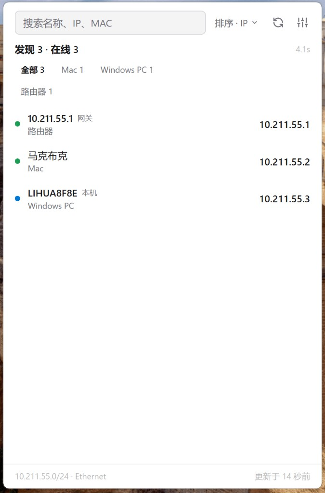
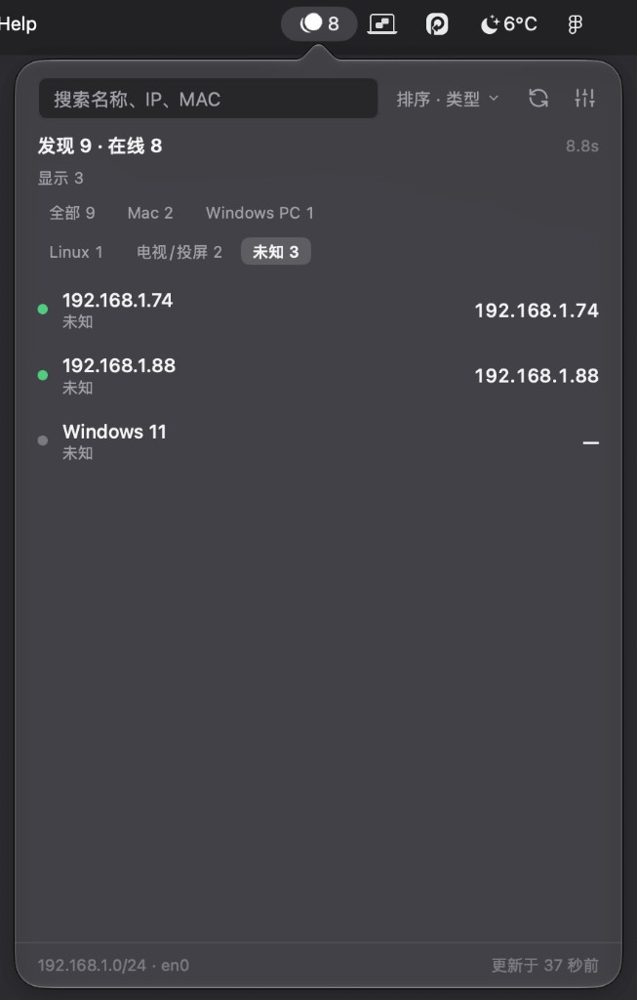

# mylan

局域网设备菜单栏应用。macOS 扫描使用内嵌的 [lanmac](embed/lanmac)，Windows 扫描使用系统网卡、邻居表和 ICMP。界面是 MyGo 原生浮层。

点菜单栏图标打开面板：列表查看设备、搜索、按类型筛选、给设备写备注、监控某个 IP。刷新在顶栏，快捷键 `⌘R`。监控的 IP 在下次扫描里上线、离线、换成别的设备或改了名称时，会发一条系统通知。结果超过 2 分钟后再打开面板会自动扫一次。

A menu-bar app for devices on the local network. On macOS, scanning uses the embedded [lanmac](embed/lanmac). On Windows, it uses the system adapter, neighbor table, and ICMP. The panel is a native MyGo flyout.

Click the menu-bar icon to open the panel: a list, search, a type filter, a note on a device, and a watch on one IP. Refresh is in the header, or `⌘R`. A watched IP sends a notification when the next scan finds it online, offline, replaced by another device, or renamed. Opening the panel again after two minutes scans once more.

## 效果

Windows 上打开面板，列出当前网段里的设备。



macOS 上从菜单栏打开同一块面板。图标后面的数字是在线数量，可以在设置里关掉。



## 安装

发布页提供这些安装包：

| 系统 | 安装包 |
| --- | --- |
| macOS（Apple 芯片） | `mylan 0.3.0 arm64.dmg` |
| macOS（Intel） | `mylan 0.3.0 amd64.dmg` |
| Windows（x64） | `mylan Setup 0.3.0 amd64.exe` |
| Windows（ARM） | `mylan Setup 0.3.0 arm64.exe` |

Linux 目前不能发现设备，所以不发布 Linux 安装包。

### macOS

- 按芯片选择 dmg，打开后把 `mylan.app` 拖进「应用程序」。
- 这是菜单栏应用，程序坞里没有图标。点菜单栏图标打开面板，右键打开菜单。图标后面默认显示在线数量，设置里的「显示数量」可以关掉。
- 设置里的「开机自启」会在登录后自动打开 mylan。macOS 若询问，到「系统设置 → 通用 → 登录项」里允许。
- 第一次运行请允许「本地网络」。不允许的话，Bonjour 发现不到设备。
- 扫描使用系统自带的 `python3`，还要用到 `ping`、`arp`、`dns-sd` 和 `smbutil`。
- 完整扫描会 ping 当前网段，大约几秒。设置里可以改成快速模式、包含休眠设备、用 SMB 补名称，或指定网段。
- 安装包目前没有 Apple 公证。换一台 Mac 打开时，若系统拦截，到「系统设置 → 隐私与安全性」里允许。

### Windows

- 按处理器选择安装包：x64 或 ARM。
- 设置里的「开机自启」会在登录后自动打开 mylan。
- 扫描读取网卡和默认路由得到网段，用 ICMP 判断在线，用邻居表读取 MAC，再用 mDNS 和 NetBIOS 补名称。不需要安装 Python。
- 第一次扫描时，防火墙若询问专用网络，请允许。不允许的话，ping 和名称发现会不完整。
- 设置里的「用 SMB 补名称」在 Windows 上改为查询 NetBIOS。快速模式跳过 ping，只根据邻居表判断在线。网段大于 /22 时会要求改成更小的范围，例如 `192.168.1.0/24`。

## 开发

需要 Go 1.27 或更新版本。在 Mac 上开发时还要系统自带的 `python3`。

```sh
go tool mygo doctor
go tool mygo dev
```

## 打包

当前系统打一个包：

```sh
go tool mygo build
```

一次打出 Apple 芯片、Intel，以及 Windows x64 和 ARM：

```sh
go tool mygo build -platform darwin/arm64,darwin/amd64,windows/amd64,windows/arm64
```

给更新签名时带上私钥：

```sh
export MYGO_UPDATER_PRIVATE_KEY="$(cat "$HOME/Library/Application Support/mygo/update-keys/mygo-update.key")"
go tool mygo build -platform darwin/arm64,darwin/amd64,windows/amd64,windows/arm64
```

私钥只留在本机，以及仓库的 `MYGO_UPDATER_PRIVATE_KEY` secret。不要放进仓库。

## 发布

版本写在 `mygo.json` 的 `version`，说明写在 `CHANGELOG.md` 里同号的 `## 版本`。推送同号的 tag 会生成草稿 Release，并上传各系统的安装包：

```sh
git tag v0.3.0
git push origin v0.3.0
```

---

## What it looks like

On Windows, the panel lists the devices on the current subnet.


On macOS, the same panel opens from the menu bar. The number after the icon is how many devices are online, and Settings can hide it.


## Install

The release page has these packages:

| System | Package |
| --- | --- |
| macOS (Apple silicon) | `mylan 0.3.0 arm64.dmg` |
| macOS (Intel) | `mylan 0.3.0 amd64.dmg` |
| Windows (x64) | `mylan Setup 0.3.0 amd64.exe` |
| Windows (ARM) | `mylan Setup 0.3.0 arm64.exe` |

Linux cannot discover devices yet, so no Linux installer is published.

### macOS

- Pick the disk image for the Mac's chip, then drag `mylan.app` to Applications.
- The app lives in the menu bar and has no Dock icon. Click the icon for the panel. Right-click for the menu. The online count appears after the icon unless Settings turns it off.
- Open at login is in Settings. If macOS asks, allow mylan in System Settings → General → Login Items.
- Allow Local Network the first time it asks. Without that, Bonjour cannot find devices.
- Scanning uses the system `python3`, plus `ping`, `arp`, `dns-sd`, and `smbutil`.
- A full scan pings the current subnet and takes a few seconds. Settings can switch to fast mode, include sleeping devices, fill in names over SMB, or set a subnet.
- The package is not notarized by Apple. If another Mac blocks it, allow it in System Settings → Privacy & Security.

### Windows

- Pick the installer for the processor: x64 or ARM.
- Open at login is in Settings. It starts mylan after you sign in.
- The scan reads the adapter and default route for the subnet, ICMP for who is online, the neighbor table for MAC addresses, then mDNS and NetBIOS for names. Python is not required.
- The first scan may ask the firewall about private networks. Allow it. Otherwise ping and name lookup stay incomplete.
- The setting that fills names over SMB queries NetBIOS on Windows. Fast mode skips ping and treats the neighbor table as online. A prefix larger than /22 is refused; use a smaller one such as `192.168.1.0/24`.

## Develop

Go 1.27 or newer. On a Mac, the system `python3` as well.

```sh
go tool mygo doctor
go tool mygo dev
```

## Build

One package for the machine you are on:

```sh
go tool mygo build
```

Mac and Windows packages together:

```sh
go tool mygo build -platform darwin/arm64,darwin/amd64,windows/amd64,windows/arm64
```

Sign updates with the private key:

```sh
export MYGO_UPDATER_PRIVATE_KEY="$(cat "$HOME/Library/Application Support/mygo/update-keys/mygo-update.key")"
go tool mygo build -platform darwin/arm64,darwin/amd64,windows/amd64,windows/arm64
```

Keep that key on this machine and in the `MYGO_UPDATER_PRIVATE_KEY` repository secret. Do not commit it.

## Release

`version` in `mygo.json` is the version. The matching `## version` section in `CHANGELOG.md` is the note. Pushing the tag of that version creates a draft release and uploads every system's package:

```sh
git tag v0.3.0
git push origin v0.3.0
```
